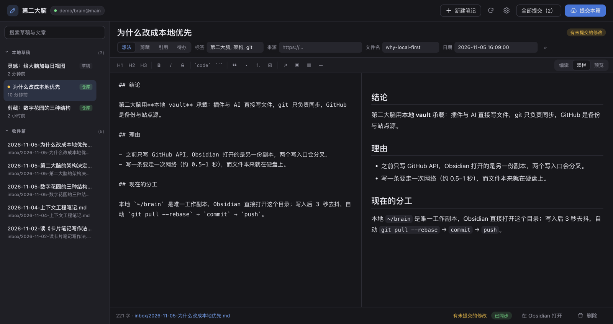
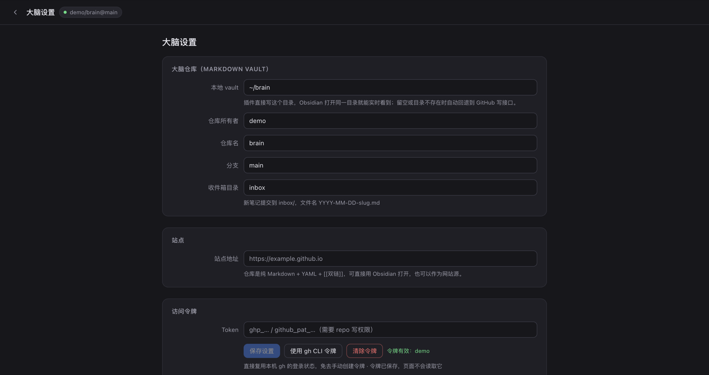

# 第二大脑 · dsh-brain

DeepSeek Harness 的侧边栏第二大脑：随手记想法、剪藏外部信息，AI 在对话里主动帮你归档，全部落成一个 **Obsidian 兼容的 Markdown vault**，并自动用 git 同步到你自己的私有仓库。

```
侧边栏 / AI ──写──▶  ~/brain（本地 vault，Obsidian 直接打开）
                          │ 3 秒去抖，git pull --rebase → commit → push
                          ▼
                 GitHub 私有仓库（备份 / 多端 / 站点源）
```



<sub>写作页（示例数据）：左边是本地草稿和仓库收件箱，中间写 Markdown，右边实时预览；标题旁的橙色胶囊表示这篇有未提交的修改，「全部提交」会统计所有待提交笔记。</sub>



<sub>设置页：本地 vault 路径、仓库信息、访问令牌与站点地址。</sub>

## 为什么是本地优先

笔记是文件，不是某个 App 的数据。插件和 Obsidian 读写同一个目录，没有第二份副本，也就不存在「两边不同步」；git 只是备份与多端同步层，不在写字的必经路径上。

- 断网照常写，Obsidian 毫秒级看到新内容；
- `brain_search` 直接扫本地 Markdown，不受 GitHub 搜索索引影响；
- 换一台没 clone 仓库的机器时，自动回退到 GitHub Contents API。

## 功能

### 写作
- 侧边栏独立面板，不占会话；顶部写标题与正文，`⌘Enter` 提交。
- 四种笔记类型：**想法 / 剪藏 / 引用 / 待办**，带 `tags` 与 `source`（来源 URL）。
- 完整 Markdown 渲染：标题、强调、删除线、行内/围栏/缩进代码、嵌套引用、嵌套列表、任务列表、对齐表格、脚注、自动链接、HTML、转义。
- Obsidian 扩展：`[[双链]]` 可点击（点了在列表里搜索该标题）、`> [!note]` callout 有样式。
- 编辑 / 双栏 / 预览三态，双栏滚动同步；工具栏 + `⌘B` `⌘I` `⌘K`。
- 本地草稿自动保存；未提交的改动在标题旁、底栏、列表圆点三处提示。
- **提交本篇** / **全部提交（N）**：单篇写盘，或一次写入所有待提交笔记并立即同步。
- 列表悬停出现 `×`、右键直接删除（两步确认）；删除仓库笔记会同步删除远端文件，git 历史仍可找回。

### 主动收集（AI 侧）
插件注册两个工具：

| 工具 | 作用 |
| --- | --- |
| `brain_save` | 把对话中值得长期保留的想法/结论/链接/待办写成笔记，带类型、标签、来源，直接入库 |
| `brain_search` | 检索 vault 里的历史笔记，回答「上次那个结论」前先翻一遍 |

### 同步
- 写入后 3 秒去抖：`git add -A` → 有改动才 `commit` → `pull --rebase` → `push`。
- 提交信息写清楚改了什么：`brain: add inbox/2026-11-05-xxx.md`，多文件时给统计并在正文列文件。
- 安全网：插件启动 1.5 秒、运行期每 60 秒检查一次，有未提交改动就补提交（覆盖 Obsidian 里的直接修改）。
- 冲突不自动解决：`pull --rebase` 失败会 abort 并在底栏显示「同步失败」。

## 安装

```bash
git clone https://github.com/supeBam/dsh-brain.git ~/code/dsh-plugins/dsh-brain

DSH_CLI="$(command -v dsh || echo '/Applications/DeepSeek Harness.app/Contents/Resources/runtime/cli/bin/dsh')"
"$DSH_CLI" plugin --profile desktop add link:"$HOME/code/dsh-plugins/dsh-brain"
```

装完 `⌘Q` 完全退出 DeepSeek Harness 再打开，左侧边栏出现大脑图标。

## 首次使用

1. **准备 vault 仓库**（私有）：
   ```bash
   mkdir -p ~/brain/{inbox,notes,clips,daily}
   cd ~/brain && git init && git remote add origin <你的私有仓库地址>
   ```
   也可以直接 `git clone` 一个已有仓库到 `~/brain`。
2. 面板右上角齿轮 → 填「本地 vault」（默认 `~/brain`）、仓库所有者、仓库名、分支、收件箱目录。
3. 令牌：点「使用 gh CLI 令牌」复用本机登录，或粘贴一个有 `repo` 写权限的 PAT。
4. 保存设置（会重载插件），回到编辑页开始写。
5. 想用 Obsidian：`Open folder as vault` 选 `~/brain`，之后插件写的每条笔记它都会立刻显示。

## 配置项

| 字段 | 说明 | 默认 |
| --- | --- | --- |
| 本地 vault | 插件直接写的目录；不存在时回退 GitHub API | `~/brain` |
| 仓库所有者 / 仓库名 | `owner/repo`（回退远程模式或 HTTPS 兜底推送时需要） | 空，首次配置时填 |
| 分支 | 提交目标分支 | `main` |
| 收件箱目录 | 新笔记落点，留空为根目录 | `inbox` |
| 站点地址 | 可选，用于「打开站点」 | 空 |

## 笔记格式

```markdown
---
title: 第二大脑的结构
type: thought
created: 2026-11-05T15:30:00+08:00
tags: [设计, 工具]
source: https://example.com/article
---

正文，可以用 [[另一条笔记]] 建立双链。
```

约定：文件名 `YYYY-MM-DD-slug.md`（日期前缀保证双链唯一），一条笔记一个主题，剪藏/引用必须写 `source`。

## 安全

- 令牌只写入宿主 credentials 记录，页面拿不到；页面通过同源 `POST /brain/api` 发指令。
- 令牌每次请求时解析，轮换后下一次提交立即生效；环境变量 `GITHUB_TOKEN` / `GH_TOKEN` 可作为后备。
- 插件代码里没有你的笔记：代码仓与本地的 vault 仓是分开的两个仓库。

## 限制

- 只处理文本文件（`.md` / `.markdown`）。
- 本地写入依赖本机 git 可推送到远端；SSH 失败时会尝试用已存令牌走 HTTPS。
- 冲突需要你手动解决，插件不会自动覆盖。

## 目录结构

```
index.js          宿主半边：本地 vault 读写、git 同步、GitHub 回退、brain_save / brain_search
client.js         浏览器半边：侧边栏、写作页、Markdown 渲染器
cordis.patch.yml  bundle 行与默认配置
locale/           插件列表标题与描述
icon.svg          侧边栏图标
```

## 许可

MIT，见 [LICENSE](LICENSE)。

Copyright (c) 2026 superfox (github.com/supeBam)
